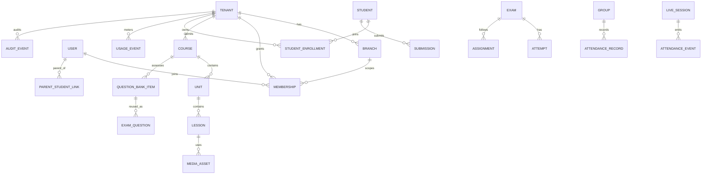

# معمارية المنصة الكاملة

## الوضع والقرار

التطبيق الحالي React/Vite + Express/TypeScript + MySQL مع modules تعليمية وشريحة SaaS جزئية. التصميم المقترح Modular Monolith بخدمات domain وفصل workers عند الحاجة، وليس افتراضًا أن كل endpoint آمن أو tenant-aware. المرجع الفعلي هو [audit](ARCHITECTURE_AUDIT_AND_MIGRATION_PLAN_AR.md) مع مطابقة بيئة التشغيل قبل كل migration. الأمن والعزل يسبقان كل سطح منتج.

## حدود المجالات

`identity/session`, `platform-admin`, `tenant/organization`, `catalog`, `student/enrollment`, `media`, `assessment`, `assignment`, `gradebook`, `groups/schedule/attendance`, `live-session`, `parent-link`, `notifications`, `usage-metering`, `moderation`, `support`, `audit`, `export`.

كل module يملك services/validation/repos/event contracts؛ REST versioned للمعاملات، outbox موحد للأحداث اللازمة، worker jobs idempotent مع tenant+actor context. لا خدمة خارجية قبل مبرر حمل/فريق. Cache key/job/object path يتضمن tenant ID، ولا تعتمد صلاحية على cache stale.

## tenancy وبيانات الملكية

- `users` هوية عامة؛ `tenants` مؤسسة/مركز؛ `branches` فروع؛ `memberships(tenant_id,user_id,branch_id?,role,status,permissions_version)` علاقة فاعلة. الطالب نفسه يمكن أن يملك membership/enrollment منفصلة بكل مؤسسة.
- كل مورد tenant-owned يحمل `tenant_id` صريحًا. استخدم PK مركبًا `(tenant_id,id)` وFK مركبًا لكل العلاقات الداخلية، مع domain ID عالمي إذا لزم خارجيًا.
- tenant الفعّال مصدره membership مصادق عليها + نطاق/host مملوك ومتحقق؛ لا من body/query/header غير موثوق. Platform admin صلاحية صريحة منفصلة.
- parent link منفصل: `parent_student_links` بحالة pending/verified/revoked، صلة وscope حقول محددة؛ parent ليس عضوًا في لوحة المدرس.
- كل row legacy غير قابل للنسبة يظل معزولًا عن مسارات القراءة حتى reconciliation موثق؛ لا تخمين owner من رقم أو آخر دفع.

## ERD مجال مستهدف

أضف `tenant_id` وbranch scope إلى سجلات الاختبار والواجب والمحاولات والدرجات والتعليقات والحضور والتسجيل الحي والإشعارات والتصدير، دون ترك علاقات متداخلة بلا FK مركب. النماذج في هذا ERD ليست وصفًا لقاعدة الإنتاج المنشورة.

## API والـjobs

كل route محمي بـ`authenticate` ثم `authorize(capability, resource)` ثم `requireTenantMembership` مع validation DTO؛ public routes allowlist معلنة. أمثلة:

| المجال | API نمطي | ضمان |
|---|---|---|
| tenant/member | `POST /v1/platform/tenants`, `/v1/tenants/:id/members` | audit، idempotency، صلاحية منصة منفصلة |
| learning | `/v1/courses`, `/v1/lessons`, `/v1/enrollments` | tenant من principal والتحقق من الاستحقاق |
| assessment | `/v1/question-bank`, `/v1/exams/:id/attempts` | توقيت/محاولة خادمية، نسخة امتحان ثابتة |
| media/live | `/v1/media/sessions`, `/v1/live/sessions`, callbacks verified | token قصير، توقيع webhook/server callback، recheck tenant |
| parent | `/v1/parent-links`, `/v1/parent/learners/:id/report` | challenge/verified scope وقراءة فقط |
| meter/export | `/v1/platform/usage`, `/v1/tenants/me/export` | مصدر server events، موافقة/سجل وصول |

الأسماء توجيهية حتى migration contract؛ لا تدّع وجود endpoint قبل البناء. Jobs لكل من transcoding، live recording، notification، report/export، import، moderation وusage rollup: idempotency key، retry cap/dead-letter، tenant+actor context، TTL، audit وقياس زمن/فشل.

## تخزين وتوسع وعمليات

MySQL InnoDB بمخطط/migrations موحدة؛ Redis للcache والqueue فقط بعد تعريف failover؛ object storage خاص بأسماء tenant مع signed URLs قصيرة؛ CDN/WAF للحافة. Workers منفصلون منطقيًا لفيديو وملفات/استيراد وتقارير ورسائل. نسخ مشفرة بموقع مستقل، restore drills، RPO/RTO/SLO تحدد بعد اختبار الحمل وعقود التخزين. read replicas/multi-region بعد قياس read load/latency والاتساق، لا كمرحلة أولى تلقائية. usage metering لا يعتمد على bill vendor وحده؛ يسجل events وي reconcile مع provider.

## قرار / بدائل / لماذا

| القرار | المرفوض | السبب |
|---|---|---|
| توسيع التطبيق الحالي بحدود domain وtenant isolation ثم فصل worker | إعادة كتابة LMS كاملة بلا جرد | تقل تكلفة التغيير مع عدم افتراض أمان legacy |
| schema مشتركة مع FK مركبة وscope مركزي | `tenant_id` في بعض الجداول فقط | العلاقات المتداخلة والتقارير والjobs تتسرب إن غاب invariant |
| owner resolution مراجَع + quarantine للغموض | backfill تخميني | حفظ الخصوصية والبيانات قبل convenience |
| multi-region بعد SLO/DR evidence | multi-region writes مبكرًا | إدارة الاتساق والتعافي لها تكلفة وحاجة مثبتة |
